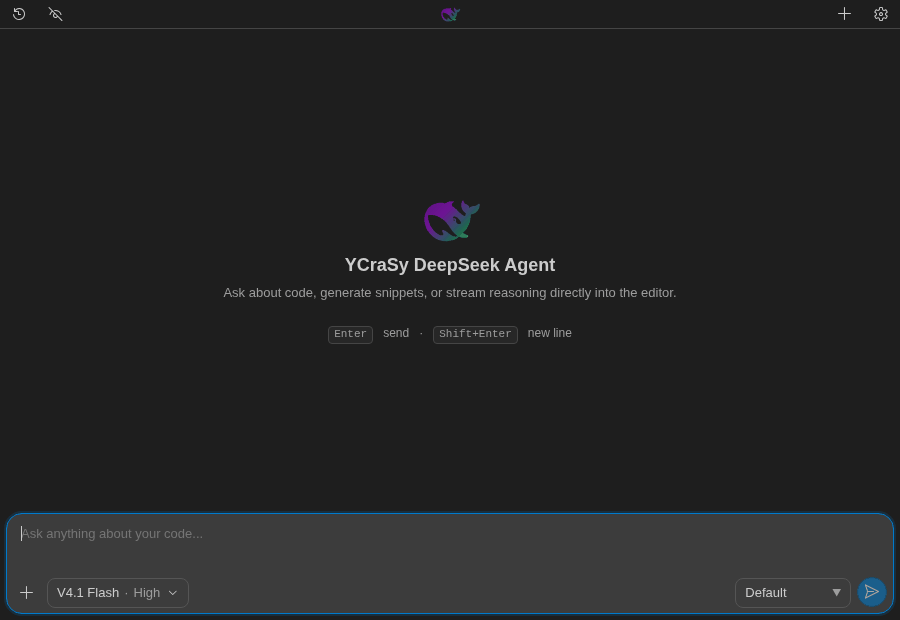

# YCraSy DeepSeek Agent

A DeepSeek-powered coding assistant for VS Code. Ask questions, explore your project, and review the changes it makes—all from your editor.

> **Preview:** This extension is under active development. Updates may introduce breaking changes and make previously saved chats or state incompatible. Back up anything you need to keep before updating.

## Highlights

- Streaming chat with reasoning and tool activity in one timeline.
- Explore, edit and test your project with workspace tools and web research.
- Share files, editor selections and images, including pasted screenshots.
- Review changes and revert a turn while protecting your own edits.
- Customize the agent with global and workspace instructions.
- Keep separate conversations, drafts and history for each workspace.
- Enable optional DeepSeek beta features, including editor completions and chat suggestions.
- Choose your permission mode and use the interface in English, Spanish or Chinese.

## Requirements

- VS Code 1.131.0 or newer.
- A [DeepSeek API key](https://platform.deepseek.com/api_keys).
- Network access to your configured API provider.

## Get started

1. Install the extension and open **YCraSy DeepSeek Agent** from the Activity Bar.
2. Open **Settings** and enter your DeepSeek API key.
3. Choose a permission mode and send your first message.

## Documentation

- [User guide](https://ycrasystudio.github.io/deepseek-agent/en/user-manual/)
- [Documentación en español](https://ycrasystudio.github.io/deepseek-agent/es/user-manual/)
- [中文文档](https://ycrasystudio.github.io/deepseek-agent/zh/user-manual/)
- [Technical wiki](wiki/INDEX.md)
- [Release notes](CHANGELOG.md)
- [Report a bug or request a feature](https://github.com/YCraSyStudio/deepseek-agent/issues)

## Privacy and safety

YCraSy DeepSeek Agent does not collect usage telemetry. To provide its features, the extension transmits prompts, selected context, tool results, images and related conversation data to the configured API provider. Those requests and responses are subject to the provider's privacy policy and API terms.

YCraSy DeepSeek Agent is an independent third-party extension. It is not affiliated with, endorsed by, sponsored by, or officially maintained by DeepSeek.

For more information, see the [user guide](https://ycrasystudio.github.io/deepseek-agent/en/user-manual/#privacy).

## License

[MIT](LICENSE)
