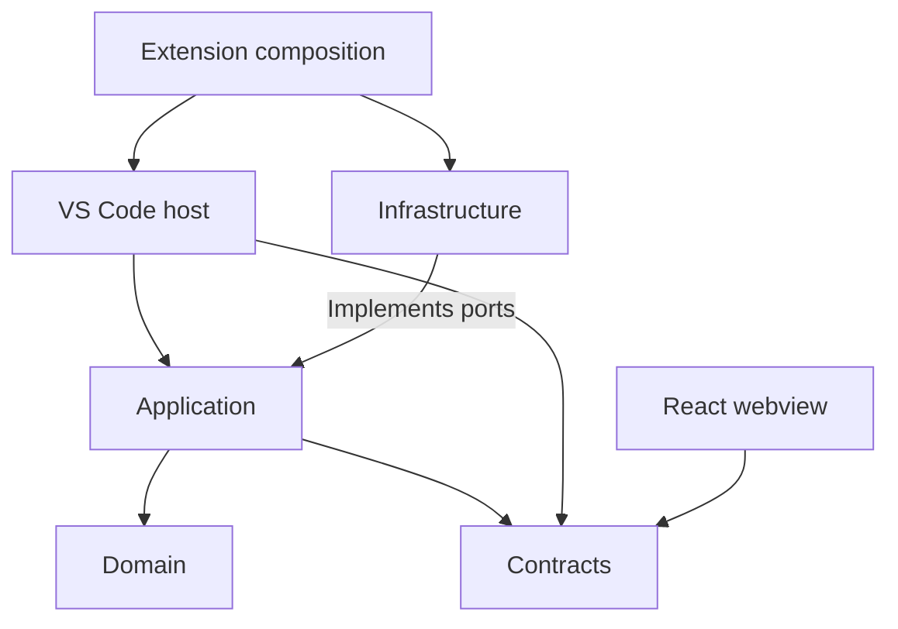

[Back](2.INDEX.MD)

# Dependency Rules

## Hard rules

- `src/application` must not import `vscode`, React, or concrete HTTP clients.
- `src/contracts` must not import `vscode`, React, filesystem, or HTTP clients.
- `src/ui` must not import Node extension code.
- `src/infrastructure` must not import React or VS Code UI code.
- API-origin policy belongs to `src/shared/security`; it is not provider-owned.
- `apiKey` must not be stored in settings; it only belongs in `SecretStorage`.
- The extension is DeepSeek-only: do not add Ollama branches or a multiprovider selector.

## Allowed direction

The diagram shows selected source dependencies. An arrow points from the importing layer to the layer it depends on.

- `vscode` may depend on `application`, `contracts`, `infrastructure`, and `shared`.
- `application` may depend on `contracts` and runtime-neutral `shared` modules.
- `infrastructure` may depend on `application`, `contracts`, and `shared`.
- `ui/chat` should communicate with the backend only through the message contract.
- Concurrent generations must use an async-scoped `ToolWorkspace`; do not switch the process-wide host while a run is active.
- Conversation writes remain serialized per conversation, and mutating tools remain serialized per workspace.

## When to create an interface

Create an interface when domain logic needs to:

- read files.
- write files.
- list directories.
- search content.
- execute commands.
- access the active workspace.

The port belongs in `src/application/ports`; concrete implementations live in `src/infrastructure` or `src/vscode`.

ESLint enforces these directions with scoped `no-restricted-imports` rules. `src/test/architecture/LayerBoundaries.test.ts` resolves aliases and relative imports to guard the same boundaries in the unit suite.

## Feature boundaries

Group code around a cohesive capability within its layer. Expose only the contracts needed by consumers, keep implementation imports explicit, and wire concrete adapters in the extension composition root. A feature should be replaceable or removable without requiring unrelated features to import its internals. Layer and cycle checks do not by themselves prove feature independence; review feature dependencies and public contracts when extracting a capability.

Start with large coordination files, identify distinct responsibilities and behavior tests, then extract one cohesive piece at a time. Preserve message contracts, persistence keys and cancellation semantics; validate the extracted behavior and affected integration flows. Size guidelines and exceptions are in [Conventions](../development-and-releases/conventions.md).

[Back](2.INDEX.MD)
