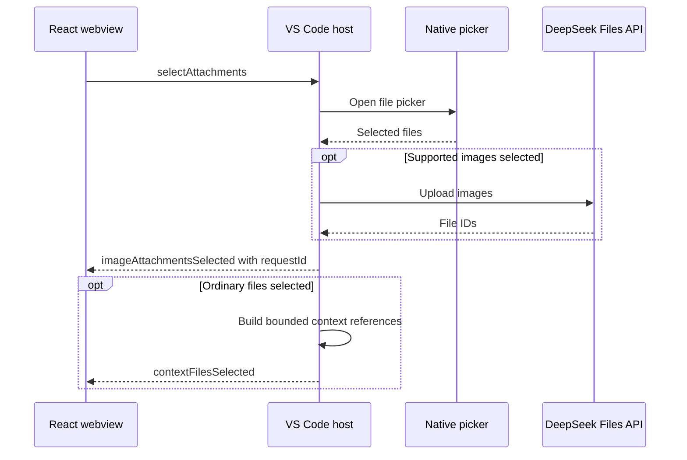

[Back](2.INDEX.MD)

# Message Contract

Protocol version 5 is defined in `src/contracts/messages/WebviewProtocol.ts` and split across `WebviewModels.ts`, `WebviewRequests.ts`, and `WebviewEvents.ts`. React communicates only through validated `postMessage` values.

## Chat and generation requests

- `sendMessage`: unique `clientRequestId`, conversation, text, referenced files, image attachments, and displayed workspace revision.
- `steerGeneration`: queues guidance first and interrupts the named generation.
- `cancelGeneration`: targets `requestId`, `conversationId`, and `generationId`; acknowledgement is accepted or stale.
- `getGenerationSnapshot`: restores correlated active state, queue, and recovery data.
- `consumeRecoveredDraft`: consumes one queued prompt recovered from checkpoint.

Every generation-scoped event carries `conversationId` and `generationId`. Terminal outcomes distinguish `completed`, `cancelled`, `interrupted`, and `error`, with a typed stop reason. Late, stale, or background events cannot bind a blank or different conversation.

## Attachments

A successful picker request can include images and ordinary files in the same selection.

- `selectAttachments`: opens one native picker. The host returns context snapshots for ordinary files and uploads detected images.
- `uploadClipboardImage`: transfers one bounded clipboard image as transient Base64 for host upload.
- `deleteImageAttachment`: removes a draft image remotely and locally when possible.
- `imageAttachmentsSelected`: returns uploaded metadata and presentation URIs.
- `imageAttachmentDeleted`: acknowledges cleanup.
- `contextFilesSelected`: returns bounded internal references or external read-only snapshots from the same unified selection.

The removed `selectContextFiles` and `selectImageAttachments` request formats are not part of protocol 5.

## Configuration, storage and customization

- Settings: `getConfig`, `saveConfig`, `resetConfig`, `testConnection`, and `deleteApiKey` use correlated requests, authoritative revisions, and masked credential status.
- Data directory: `selectStorageDirectory`, `setStorageDirectory`, and `reloadStorage` return `storageDirectoryResult`.
- Instructions: `getReusableInstructions`, `createReusableInstruction`, `openReusableInstruction`, `getWorkspaceInstructions`, `openWorkspaceInstructions`, and `openGlobalAgents`.
- History transition: `resolveHistoryTransition` answers a `historyTransitionRequired` event with `stop`, `save`, `discard`, or `cancel`.

## History and navigation

- History: `getHistory`, `loadConversation`, `loadConversationPage`, `deleteConversation`, and `deleteConversations` use navigation IDs and opaque pagination cursors.
- Navigation: `newConversation` binds a blank view only through its matching `newConversationReady`.
- Generation recovery: `getGenerationSnapshot` restores active runs, queues, and recoverable drafts; `consumeRecoveredDraft` consumes one.
- Context: `compactContext` requests manual compaction and is answered by `contextCompactionResult`, with `contextCompactionUpdated` progress events.

## Tools and workspace

- Tools: `executeToolCall`, `getAvailableTools`, `openFile`, `openFileDiff`, `reviewWorkspaceTurn`, `getWorkspaceTurn`, and `revertWorkspaceTurn`.
- Screenshots: `getScreenshotPreview` and `openScreenshot` return `screenshotPreview` or open the stored image.
- Workspace: `getWorkspaceContext`, `rebindConversationWorkspace`, `openConversationWorkspace`, and `getPathCompletions`.
- Running tasks: `getRunningTasks` and `stopRunningTask` return `runningTasks`.
- Code actions: `copyCode`, `insertCode`, and `selectModel`.

## Editor and chat suggestions

- `getChatSuggestion` requests a manual continuation for the current draft; `cancelChatSuggestion` aborts it.
- `chatSuggestion` returns the bounded text and is matched by `requestId`.
- Editor inline completions run in the host through the VS Code provider and do not cross this message contract. See [editor assistance](editor-assistance.md).

## Main outgoing events

- Lifecycle: `generationAccepted`, `messageQueued`, `generationActivityChanged`, `generationSnapshot`, `cancelGenerationResult`, `newConversationReady`, and `historyTransitionRequired`.
- Streaming: `streamTimelineDelta`, `streamTimelineToolGroup`, `showTyping`, `streamDone`, `streamError`, `contextCompactionUpdated`, `contextCompacted`, `contextWindowUpdated`, `generationRecoveryStarted`, and `resourceLimitReached`.
- Tools: `toolCallStarted`, `toolCallResult`, `toolCallActionAccepted`, `toolCallConfirmationRequired`, `availableTools`, and `runningTasks`.
- State: `configLoaded`, `configUpdateResult`, `connectionTestResult`, `apiKeyStatus`, `apiKeyStatusSettings`, `apiKeyDeleteResult`, `history`, `conversationLoaded`, `conversationPageLoaded`, `conversationDeleted`, `workspaceContextChanged`, `workspaceRebindResult`, `pathCompletions`, `reusableInstructions`, `workspaceInstructions`, `chatSuggestion`, `workspaceTurn`, `screenshotPreview`, and `requestRejected`.

Conversation files remain schema version 2. User and assistant messages carry generation ownership; messages may include image attachment metadata, and assistant/error messages carry one terminal generation status.

[Back](2.INDEX.MD)
