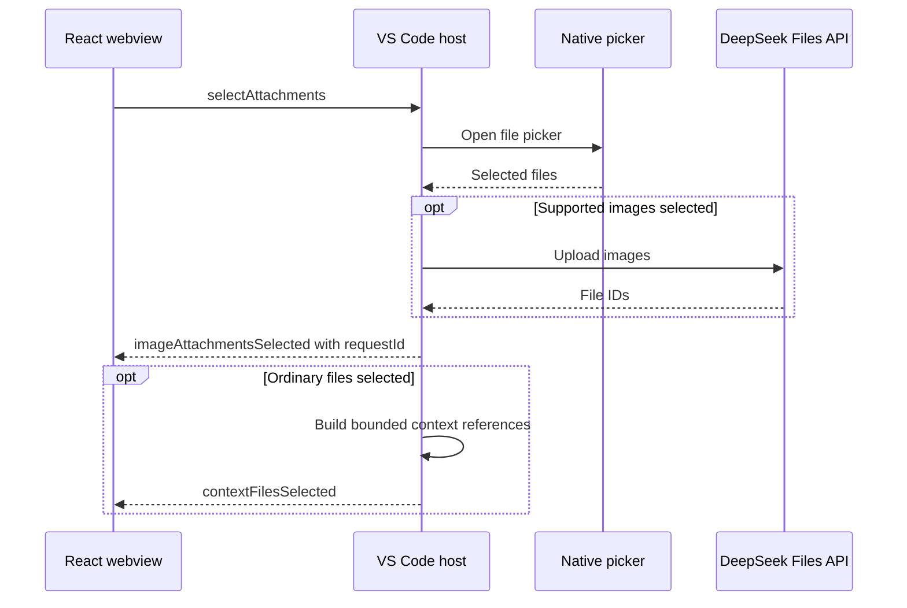

[Back](2.INDEX.MD)

# Message Contract

Protocol version 5 is defined in `src/contracts/messages/WebviewProtocol.ts` and split across `WebviewModels.ts`, `WebviewRequests.ts`, and `WebviewEvents.ts`. React communicates only through validated `postMessage` values.

## Chat and generation requests

- `sendMessage`: unique `clientRequestId`, conversation, text, referenced files, image attachments, and displayed workspace revision.
- `steerGeneration`: queues guidance first and interrupts the named generation.
- `cancelGeneration`: targets `requestId`, `conversationId`, and `generationId`; acknowledgement is accepted or stale.
- `getGenerationSnapshot`: restores correlated active state, queue, and recovery data.
- `consumeRecoveredDraft`: consumes one queued prompt recovered from checkpoint.

Every generation-scoped event carries `conversationId` and `generationId`. Terminal outcomes distinguish `completed`, `cancelled`, `interrupted`, and `error`, with a typed stop reason. Late, stale, or background events cannot bind a blank or different conversation.

## Attachments

A successful picker request can include images and ordinary files in the same selection.

- `selectAttachments`: opens one native picker. The host returns context snapshots for ordinary files and uploads detected images.
- `uploadClipboardImage`: transfers one bounded clipboard image as transient Base64 for host upload.
- `deleteImageAttachment`: removes a draft image remotely and locally when possible.
- `imageAttachmentsSelected`: returns uploaded metadata and presentation URIs.
- `imageAttachmentDeleted`: acknowledges cleanup.
- `contextFilesSelected`: returns bounded internal references or external read-only snapshots from the same unified selection.

The removed `selectContextFiles` and `selectImageAttachments` request formats are not part of protocol 5.

## Other request groups

- Configuration: `getConfig`, `saveConfig`, `resetConfig`, and `testConnection` use correlated requests and authoritative revisions.
- History: `getHistory`, `loadConversation`, `loadConversationPage`, and `deleteConversation` use navigation IDs and opaque pagination cursors.
- Tools: `executeToolCall`, `getAvailableTools`, `openFile`, and change-view actions.
- Workspace: `getWorkspaceContext`, `rebindConversationWorkspace`, `openConversationWorkspace`, and `getPathCompletions`.
- Navigation: `newConversation` binds a blank view only through its matching `newConversationReady`.

## Main outgoing events

- lifecycle: `generationAccepted`, `messageQueued`, `generationActivityChanged`, `generationSnapshot`, `cancelGenerationResult`.
- streaming: `streamTimelineDelta`, `streamTimelineToolGroup`, `streamDone`, `streamError`, `contextCompacted`, `generationRecoveryStarted`, and `resourceLimitReached`.
- tools: `toolCallStarted`, `toolCallResult`, and `toolCallConfirmationRequired`.
- state: `configLoaded`, `configUpdateResult`, `history`, `conversationLoaded`, `conversationPageLoaded`, `workspaceContextChanged`, and `workspaceRebindResult`.

Conversation files remain schema version 2. User and assistant messages carry generation ownership; messages may include image attachment metadata, and assistant/error messages carry one terminal generation status.

[Back](2.INDEX.MD)
