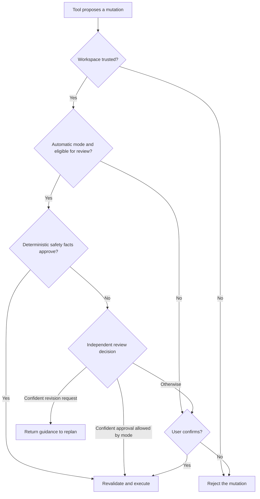

[Back](2.INDEX.MD)

# Safety and Confirmations

## Modes

The extension exposes every runtime-available tool and uses three permission modes:

- `default` asks before every tool call.
- `auto-approve` runs routine operations automatically inside or outside the workspace. Elevated and critical operations require confirmation.
- `full-access` runs routine and elevated operations automatically anywhere. It asks only for critical actions that could make the computer unusable or cause broad irreversible loss.

There is no per-tool permission matrix. Web search is the single capability toggle: disabling it removes both `search_web` and `read_web` from the definitions sent to DeepSeek.

VS Code Workspace Trust remains authoritative. An untrusted workspace captures a `default` permission snapshot and rejects mutating tools until the workspace is trusted.

## Decision flow for a mutating tool

A matching cached approval can skip the independent review request. Tools with their own explicit confirmation policy follow that policy.

## Deterministic facts before any review

When safety can be established from machine-verifiable facts, no review request is sent:

- **Workspace-contained file mutations.** `create_file`, `edit_file`, and `apply_patch` are approved automatically in automatic modes only when the declared effect is `workspace-mutation`, the host proved the target inside the bound workspace, and the path is not a sensitive file. The payload never reaches a reviewer because it cannot change those facts.
- **Finite version, help, and availability queries.** A command whose segments are all allowlisted diagnostics (`dotnet --version && node --version && npm --version`, `where node`, `command -v node`) runs directly. Any pipe, redirect, substitution, variable, background marker, inline-code flag (`-e`, `-c`), or non-allowlisted program falls back to the reviewer.
- **Verified workspace scripts.** A single script invocation runs unattended only when four facts agree: the path resolves inside the workspace, the on-disk bytes still match the agent-authored content hash, the script declares no denied capability (dynamic evaluation, download-and-execute, machine policy changes, broad process termination, escalation, interactive input, credentials, external absolute paths, background jobs), and every network destination it names is local.

`-ExecutionPolicy Bypass` passed to `powershell`/`pwsh` is a process-scoped fact and never read as elevation; `Set-ExecutionPolicy` without `-Scope Process` is treated as a machine policy change and always requires review. Missing or unreadable facts return to the reviewer: fail closed, never fail open.

Manual modes are untouched. Deterministic facts replace the automatic review call only; in `default` mode every mutation still asks the user.

## Independent DeepSeek review

Terminal commands and file mutations that the deterministic layer cannot prove in automatic modes are sent to a separate DeepSeek review request. The reviewer receives the original user request, the proposed command or a content-free file-operation description, mechanical path/shell facts, and bounded non-sensitive context for explicitly named workspace files — including the body of a script the command runs.

The reviewer returns:

- `decision`: `approve`, `revise`, or `manual_confirmation`;
- `risk`: `routine`, `elevated`, or `critical`;
- `confidence`: from `very_low` through `very_high`;
- a concise reason or replanning constraint.

Automatic approval or revision requires `medium_high` confidence or above. Invalid, unavailable, or ambiguous reviews fail closed to manual confirmation. Commands that visibly contain credentials are not transmitted to the reviewer.

## Confirmation behavior

When the active mode requires confirmation:

1. the backend sends `toolCallConfirmationRequired` with the exact command or affected path and the DeepSeek classification;
2. the UI offers execute once or cancel;
3. the backend accepts the response only for the pending `generationId` and `toolCallId`;
4. the approved operation is revalidated immediately before execution, including optimistic file hashes when available.

Preparing a file mutation never interrupts the user. The inline change preview reuses the editor that already shows the affected file, and otherwise opens a transient preview tab that preserves focus, so the pending change is visible without moving focus out of the chat input, the terminal, or another editor.

## Reviewing applied changes

Every completed `create_file`, `edit_file`, or `apply_patch` records the exact before and after contents of the written file for the current session. `View change` on the tool call, each row of the end-of-turn edited-files summary, and the summary's `Review` action open the native VS Code diff from those records, so a large change stays fully reviewable even though the diff inside a tool result is bounded for the model context.

Recovery snapshots are separate from the bounded tool-result diff. After each turn, including cancellation and errors, the extension writes real before/after copies for every changed path under `.snapshot/turns/<generation-id>/` in the chat's snapshot directory. These copies cover terminal changes too, persist across reloads, and are not memory-only. Their layout, quota and retention are in [Settings, History, and Privacy](../settings-and-data/settings-history-and-privacy.md#workspace-snapshots-and-revert); the restore flow is in [Workspace recovery](workspace-recovery.md).

When no recovery copy matches the recorded document hashes — for example after retention removed it — the change view falls back to reconstructing the excerpts stored in the tool result, and a change whose recorded diff was truncated cannot be compared.

Reverting an applied turn is available from the turn summary, the reviewed-change editor title and the `revert_workspace` tool. Restoration verifies the workspace binding, every recovery copy and the current files first; it refuses to overwrite later edits or dirty editors and leaves Git commits and the staging index untouched.

A positive reviewer decision is cached only when every justifying fact is reproducible: conversation, workspace binding, permission fingerprint, tool, normalized command or path, content hash, and effect profile. Changing the permission mode, editing the script, or running a different command produces a different key and a fresh review. User confirmations are never cached.

Terminal commands remain finite, non-interactive, cancellable, and outside an OS sandbox. Mechanical validation, workspace binding, schema validation, mutation serialization, output bounds, and process-tree cancellation remain local enforcement rather than risk classification.

[Back](2.INDEX.MD)
